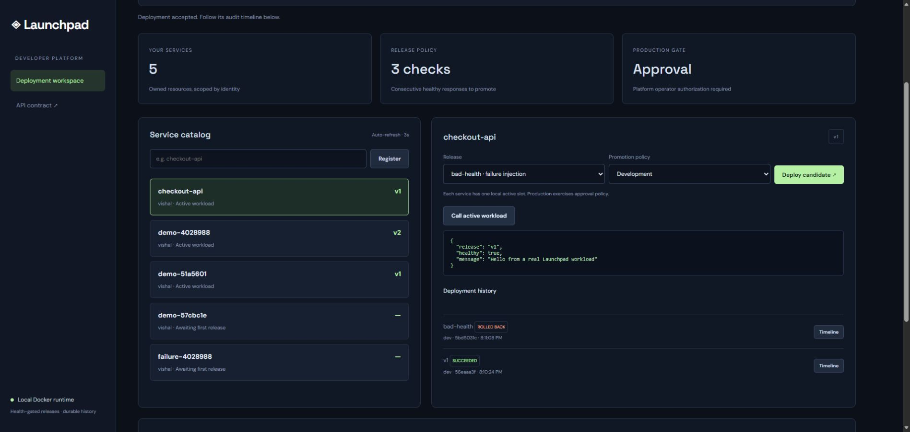
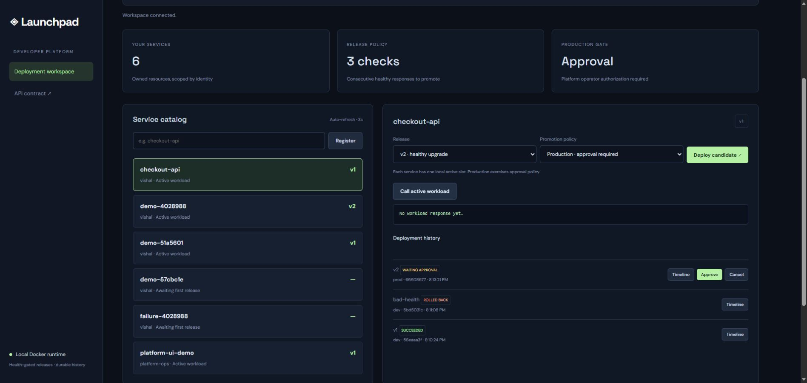
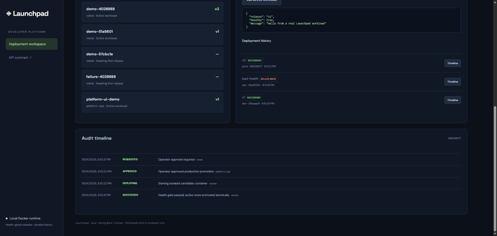
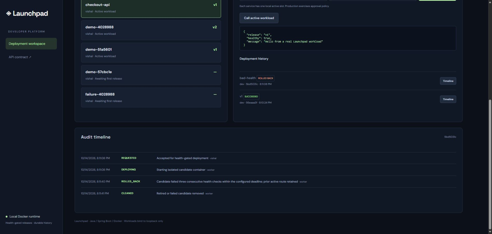

# Launchpad: screenshot walkthrough

These screenshots were captured from the running local application on **14 October 2026**. The sample `checkout-api` deploys real Docker containers. This is a local engineering lab, not a production or Azure deployment claim.

## 1. Healthy self-service deployment

A developer registers the service and deploys `v1`. The candidate passes the health gate, its deployment is marked **SUCCEEDED**, and the active workload returns its real JSON greeting.

**What to explain:** owner-scoped service APIs, validated release policy, durable deployment intent, three consecutive health probes, and atomic active-route promotion.

## 2. Failed upgrade retains the healthy release

The `bad-health` candidate returns unhealthy responses. Its deployment becomes **ROLLED BACK** while the service remains on `v1`. The response pane shows the retained healthy workload.

**What to explain:** the active route stays unchanged while the candidate is tested. Rollback means preserving the previous healthy route, rather than reverting an external database or application side effect. In-flight request draining is not implemented.

## 3. Production approval gate

A `v2` production intent is **WAITING APPROVAL**. The operator has an **Approve** control; the developer's API approval request is rejected with 403 in the acceptance tests. The service still has an active `v1` release during the wait.

**What to explain:** developers can request deployments, while a separate operator role controls production approval. In this lab, dev/prod choose policy on one local active slot; they are not isolated cloud environments.

## 4. Attributable approval and promotion

The operator approves the intent. The timeline records **APPROVED** with actor **platform-ops**, followed by worker execution and successful promotion of `v2` after its health gate.

**What to explain:** approval and state transitions are stored with actor identity; deployment status and active-route updates commit together. Audit records are append-only through the API, not tamper-proof against a host administrator.

## 5. Rollback and cleanup timeline

The failed upgrade's timeline records **REQUESTED → DEPLOYING → ROLLED_BACK → CLEANED**. Cleanup is acknowledged only after the owned candidate has been removed; failed cleanup can be retried from durable history.

**What to explain:** there is no transaction spanning SQL and Docker. Deterministic container identities, ownership labels and reconciliation address the crash windows. A separate real abrupt-restart scenario verified reuse of the same container ID.

## Supporting evidence

- [Verification record](verification.md): 17 integration tests, nine live acceptance checks, abrupt-restart recovery, container packaging checks and the Terraform local lifecycle.
- [Portable evidence summary](../evidence/summary.json): observed results without bearer tokens or host logs.
- [Architecture and failure analysis](architecture.md): transaction boundaries, crash windows, health policy and security tradeoffs.
- [Resume bullets and five-minute demo](resume-and-demo.md): factual project wording and interview narration.

For an email or interview, start with screenshots 1-3 and keep the audit screenshots available for deeper discussion. Use the repository's verification record to substantiate the claims; screenshots alone are not performance or availability measurements.
